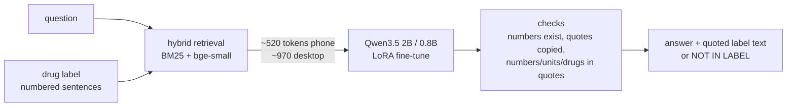

# Gate 2: fine-tune plus checks (C) against base model plus passages (B), dev set

RESULT_PLACEHOLDER

Everything here uses the **development split only**: 43 dev labels with kept items, 882 answerable and 378 decline items. T1 test, T2, T3, T4 and T5 were not used for any run, tuning or choice (see [Data hygiene](#data-hygiene)).

## What was built



| Piece | Python | Browser (JS) | Shared tests |
|---|---|---|---|
| Sentence splitting and numbering | `datapipe/src/medlabel_data/sentences.py` | `core/sentences.js` | `core/fixtures/text_cases.json` (300 sentences) |
| Tokens, lexicon, restatement check | `medlabel_data/text.py` | `core/text.js`, `core/data/lexicon.json` | 80 restatement pairs in `text_cases.json` |
| Reply parsing and quote/number checks | `medlabel_data/checks.py` | `core/checks.js` | `core/fixtures/check_cases.json` (21 cases) |
| Hybrid retrieval | `medlabel_data/retrieval.py` | `core/retrieval.js` | `core/fixtures/retrieval_cases.json` (24 cases) |
| Question embedding | `train/scripts/embed.py` (onnxruntime) | `core/embed.js` (transformers.js) | cosine ≥ 0.999 on 50 dev questions |

Tests: `node --test core/tests` and `cd datapipe && uv run pytest -q`. Beyond the fixtures, the JS ports were run against Python on large dev samples: sentence splitting and tokens with 0 mismatches, and 1,764 dev retrievals (both presets) with 0 mismatches, byte for byte.

## Fine-tuning

| | Qwen3.5-2B (primary) | Qwen3.5-0.8B (lite) |
|---|---|---|
| Config | `train/configs/lora_2b.yaml` | `train/configs/lora_08.yaml` |
| Data | `mlx_plain` train split, 7,577 examples (plain-language ANSWER lines, [data.md](data.md)) | same |
| LoRA | rank 16, scale 20, dropout 0.05, all 24 layers | same |
| Schedule | 1 epoch = 1,894 steps × batch 4, LR 5e-5 cosine to 5e-6, 50 warmup steps, seed 0 | same |
| Loss | reply tokens only (`mask_prompt: true`); Qwen thinking off in the chat template | same |
| Time, peak memory (M5 Pro) | 2 h 16 min (about 4.3 s per step with validation), 18.9 GB | 08_TIME |
| Val loss (160 dev examples), start → end | 1.056 → 0.519 (min 0.418 at step 1800) | 08_VAL |

Stock `mlx_lm.lora` runs out of memory on Qwen3.5 on a 24 GB Mac. It also loops over tokens through the linear-attention layers, at about 16 s per step. `train/scripts/lora_train.py` is stock `mlx_lm.lora` with two changes:

- It computes logits only at reply positions. The vocabulary has 248k tokens, so computing logits everywhere is what runs out of memory.
- It uses a chunked gated-delta-rule implementation (`chunk_gated_delta_rule` form, `train/scripts/chunked_gdn.py`). It brings a step down to about 4 s. Tests check outputs and gradients against mlx-lm.

Prompts are rendered exactly as at run time: drug line, numbered label sentences under section headings, question. Thinking is disabled with `enable_thinking=False`, the same template the browser uses.

**Learning-rate note (0.8B).** The first 0.8B run used LR 8e-5. It diverged after warmup: train loss went 0.89 → 1.65 by step 80 and stayed near 1.4. It was stopped at step 180, and the log is kept as `medlabel-08-r1-lr8e-5-aborted.log`. The run reported here uses the 2B's LR, 5e-5. A second attempt crashed with a GPU out-of-memory error because it overlapped with a 2B evaluation; after that, training and evaluation were never run at the same time.

**Checkpoint choice (dev).** The 160-example val loss is noisy, so I compared saved 2B checkpoints on 300 dev items: phone prompts, every fourth dev item, with checks.

| 2B checkpoint | wrong | answerable correct | declined, should answer | answered, should decline | select_ok |
|---|---|---|---|---|---|
| step 800 | 12.0 | 74.9 | 12.6 | 4.4 | 78.4 |
| step 1400 | 18.3 | 77.1 | 5.7 | 12.1 | 71.1 |
| **final (1894)** | 13.3 | 76.6 | 9.1 | 5.5 | 77.0 |

Step 800 and final are within noise of each other (about ±2 points on 300 items), so I kept **final**, the planned one-epoch model. Step 800 declines more often. 08_SEL Because this choice looked at dev, C's dev numbers are slightly optimistic. T1 is the unbiased check.

## Retrieval

Plan section 5, step 3. `retrieve()` in `medlabel_data/retrieval.py` / `core/retrieval.js` works on one drug label:

1. Every label passage is split with `sentences.py` / `sentences.js`, so the numbering matches the training data.
2. Each sentence is scored as 0.3 × BM25 over the sentence plus its heading, 0.3 × BM25 over its passage, and 0.4 × cosine similarity between bge-small-en-v1.5 embeddings of the question and the sentence. Each part is min-max scaled within the label.
3. Seeds are taken best first. Each seed brings one neighbouring sentence on each side from its own passage.
4. Selection stops when the next seed doesn't fit the character budget.

Label sentence embeddings are computed ahead of time. The question is embedded at run time: in Python with onnxruntime (`train/scripts/embed.py`), in the browser with transformers.js (`core/embed.js`, q8 ONNX, about 34 MB, cosine ≥ 0.999 against Python).

**Choosing it (dev grid, `retrieval_eval.py`, `~/waicy-work/retrieval/grid_dev.json`).** The grid covered:
- 3 small embedders (all-MiniLM-L6-v2, bge-small-en-v1.5, snowflake-arctic-embed-xs);
- 4 weightings: keyword only, embedding only, and hybrids;
- context 0 or 1;
- 2 budgets.

bge-small with the hybrid weighting and one sentence of context was best or tied at both budgets. Embeddings alone were clearly worse than keywords; MiniLM alone found only 27% of answer words. The hybrid adds 1–2 points over BM25.

**Shipped presets, all 882 answerable dev questions** (`retrieval_eval.py --final`, `final_dev.json`). sent_recall is the share of gold answer sentences shown. all_gold and any_gold are the share of questions where every gold sentence, or at least one, is shown. p@k means the gold passage is ranked in the top k.

| Preset | Method | sent_recall | all_gold | any_gold | p@1 | p@3 | p@5 |
|---|---|---|---|---|---|---|---|
| Phone (1,600 chars) | BM25 only | 75.2 | 69.5 | 81.9 | 66.0 | 82.7 | 87.4 |
| Phone | bge only | 64.7 | 58.4 | 72.6 | 53.4 | 74.7 | 82.5 |
| Phone | **hybrid (shipped)** | **77.1** | **71.9** | **83.1** | **68.1** | **84.2** | **90.1** |
| Desktop (3,500 chars) | BM25 only | 82.2 | 77.4 | 88.1 | | | |
| Desktop | bge only | 73.2 | 66.7 | 81.4 | | | |
| Desktop | **hybrid (shipped)** | **84.0** | **79.7** | **89.2** | | | |

**Prompt size.** Qwen tokens per full chat prompt (system, label text, question, generation prompt), over the evaluated dev prompts:

| Prompt set | p50 | p90 | p99 | max |
|---|---|---|---|---|
| Phone | 519 | 580 | 635 | 784 |
| Desktop | 1,013 | 1,119 | 1,233 | 1,326 |
| Oracle (training-style passages) | 570 | 856 | 1,330 | 1,505 |

Phone prompts meet the Gate 1 guard of about 600 tokens at p90. Even the longest phone prompt plus 256 reply tokens fits the lite model's ctx 2048. Desktop prompts are for the 2B on laptops.

## Checks

`check_reply` (Python) and `checkReply` (JS) run the same rules on every reply:

1. Parse it as an answer (`SENTENCES:` plus `ANSWER:`), a decline (`NOT IN LABEL`), or invalid. Parsing is mildly lenient, and `strict` records exact format.
2. Every cited number must exist in the prompt; otherwise the reply is invalid, and the app shows "not in label".
3. Quotes are copied from the prompt, so a displayed quote is always label text.
4. Every number, unit and drug name in the ANSWER line must appear in the drug line or in the cited sentences. Otherwise the restatement is blocked and only the quotes are shown.

**False positives.** The check blocks 4 of 882 (0.45%) gold dev restatements.

**Regex fix.** A bug found during Gate 2: a reply cut off at 256 tokens in the middle of a long `SENTENCES:` list caused exponential regex backtracking in the number-list pattern, so grading hung. In the browser this would freeze the tab. The pattern now requires a separator between numbers and accepts exactly the same valid strings. Both languages were fixed, and a regression case was added to `check_cases.json` (22 cases).

## How Gate 2 was graded

`train/scripts/eval_dev.py` generates replies and `train/scripts/grade_dev.py` grades them. Decoding is greedy, with thinking off, max 256 new tokens, MLX on the M5 Pro. Three prompt sets cover the 43 dev labels:

| Prompt set | What the model sees | Items |
|---|---|---|
| **Oracle** | The training-style prompt: the gold passage plus distractors. For decline items, the passage with the answer is removed. | 882 answerable + 378 decline |
| **Phone** | Hybrid retrieval, phone budget, over the whole label. For decline items, the removed passage is excluded. | 746 answerable + 136 miss + 369 decline |
| **Desktop** | Same, desktop budget | 799 answerable + 83 miss + 356 decline |

"Miss" means retrieval lost the answer: the shown sentences cover less than 50% of it. Declining is then correct, and an answer is graded like an answerable one. Decline items whose retrieved text still covers half of the answer are dropped (9 phone, 22 desktop), using the same rule as `build.py`.

Per reply, from `grade_dev.py`:
- **decline expected:** declining is correct; answering is "answered when it should have declined".
- **answerable:** declining is "declined when it should have answered". An answer is correct when **select_ok** holds: the cited sentences, with their headings, cover at least 70% of the answer words the gold sentences cover, and at most max(2, number of gold sentences) cited sentences are not gold.
  - Without checks, the restatement must also have no number, unit or drug missing from the cited sentences.
  - With checks, such a restatement is blocked and only quotes are shown, so select_ok alone decides.
- **invalid** replies (unparseable, or citing a number not in the prompt) count as wrong.
- **wrong-answer rate** = (wrong + answered when it should have declined + invalid) / all items. This is the plan's headline measure.

B is scored as the plan defines it: base model plus label passages, no checks. C is the fine-tune plus checks. Both ablations are also shown: B + checks and C without checks. Differences are paired, with 95% intervals from 2,000 resamples of whole drug labels. Each dev label is a different ingredient, so this is the "resample whole drugs" rule.

**What is not graded automatically.** Whether a restatement says the same thing as the quote, beyond numbers, units and drug names. For example, a negation flip would pass. The T3 human and pharmacist grading covers this.

RESULTS_PLACEHOLDER

## Data hygiene

- Training read only `mlx_plain/train.jsonl`, through a data directory of symlinks to train and valid. Choices (learning rate, checkpoint, retrieval weights and budgets) used the dev split only.
- No model was run on T1 test, T2, T3, T4 or T5. No test question was used for any choice.
- **One incident to disclose.** While inspecting `aligned.jsonl` (which holds all splits) during development, I printed one T1 test record: an Acamprosate question, qid `bc83097f554e73b0`. No model was run on it. Nothing was tuned using it, and it does not affect T1 beyond that single item having been seen. It can be dropped from T1 if a strict reading is preferred.
- The plain-language ANSWER lines in training were written by Claude Sonnet 5.5 under automatic number, unit and drug checks ([data.md](data.md)). No evaluation data was rewritten.
- FDARxBench is a published evaluation benchmark. This project trains on part of it and holds out whole ingredients, so these scores are not comparable to the paper's.

## Limitations

- **Dev only, and dev was used for choices.** The checkpoint, learning rate and retrieval settings were picked on dev, so C's dev numbers are slightly optimistic. T1 is the clean test.
- **Automatic grading.**
  - select_ok is a word-coverage proxy for "the right sentences". The lenient rows show how much the extra-sentence limit matters.
  - Restatements are checked only for numbers, units and drug names, not for meaning.
  - The decline audit above was done by one grader who knew which system wrote each reply. The plan's blind human and pharmacist grading on T3 is the real test.
- **Decline items are built by removing the passage that holds the answer.** Labels repeat facts (Medication Guide, counseling, warnings), so some "decline" items are still answerable from what remains (see the audit). This penalises answering in general, and B more than C.
- **One run per condition** (greedy decoding, seed 0 training). Variation between training seeds is not measured.
- **MLX on the Mac is not WebLLM on a phone.** The browser uses q4f16_1 weights. Gate 1 checked that conversion keeps the model's behaviour; Gate 2's browser test below checks that the fine-tunes load and follow the format, not their accuracy.

## Commands

```bash
# training (one at a time; ~19 GB peak for the 2B)
~/waicy-work/envs/mlx/bin/python train/scripts/lora_train.py -c train/configs/lora_2b.yaml
~/waicy-work/envs/mlx/bin/python train/scripts/lora_train.py -c train/configs/lora_08.yaml
# checkpoint choice on 300 dev items
train/scripts/select_ckpt.sh 2B medlabel-2b-r1 800 1400 final
# retrieval: embed dev labels and questions, grid, shipped presets
~/waicy-work/envs/mlx/bin/python train/scripts/embed.py --model bge --split dev
~/waicy-work/envs/mlx/bin/python train/scripts/retrieval_eval.py            # grid -> grid_dev.json
~/waicy-work/envs/mlx/bin/python train/scripts/retrieval_eval.py --final    # -> final_dev.json
# Gate 2: prompts, generation + grading queue, comparison and chart
~/waicy-work/envs/mlx/bin/python train/scripts/eval_dev.py prompts
train/scripts/run_gate2.sh all
~/waicy-work/envs/mlx/bin/python train/scripts/compare_dev.py \
  --pairs B2b_oracle:C2b_oracle B2b_phone:C2b_phone B2b_desktop:C2b_desktop B08_oracle:C08_oracle B08_phone:C08_phone \
  --chart docs/img/gate2_size.png --md /tmp/gate2_tables.md
# browser build and test page
train/scripts/convert_mlc.sh 2B medlabel-2b-r1
train/scripts/convert_mlc.sh 0.8B medlabel-08-r1
python3 -u gate1/scripts/serve.py --http --host 127.0.0.1 --port 8080   # then /?model=r1-ft&prompts=label
# tests (Python and JS share core/fixtures)
node --test core/tests && (cd datapipe && uv run pytest -q)
```
