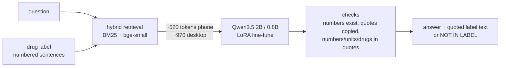
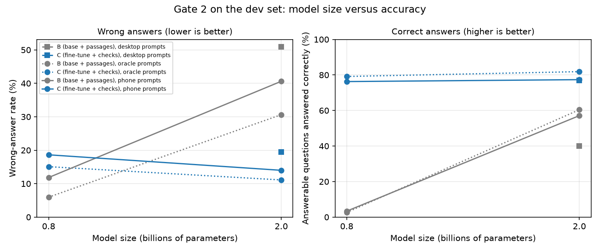
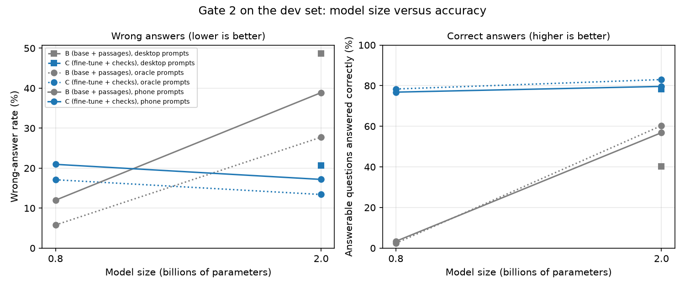

# Gate 2: fine-tune plus checks (C) against base model plus passages (B), dev set

> **Round 2 update (decline fix).** The "should decline" items were rebuilt so that items whose answer is still in the label are dropped ([data.md](data.md)). Both fine-tunes were then retrained with the same settings (the r2 adapters), and Gate 2 was re-run on the cleaned dev set. Details are in [Round 2](#round-2-decline-fix-and-retrain).
>
> - C still clearly beats B for the 2B: 17.2% against 38.9% wrong on phone prompts, −21.7 points [−25.1, −18.2]. The 0.8B result is unchanged in kind: B-0.8B declines 79% of answerable questions.
> - The "declines answerable questions" gap against B is gone. It was +5.0 points on phone prompts; it is now +0.8 [−0.4, +2.1]. The decline audit is also much cleaner: only 30% of C-2B's answered decline items are actually supported by the label, against 73% before.
> - The cost: on the same cleaned items, the r2 adapters have a **higher** wrong-answer rate than the round-1 adapters, +3.4 points at both sizes (2B 17.2% against 13.8%). They answer more items that should be declined and more retrieval misses.
> - Recommendation: by the plan's headline measure, keep the **round-1 adapters** as the default and ship the r2 builds as the alternative with fewer refusals. Both are converted and tested in the browser.
>
> The sections from "What was built" to "Browser check" describe round 1 unless stated otherwise.

**Round 1 result: Gate 2 passes for the 2B (the primary model) at every prompt setting. For the 0.8B lite model the headline measure goes the other way. The base 0.8B is not a usable B, though: it declines 79–90% of answerable questions.**

- **2B.** C (fine-tune plus checks) gives about a third as many wrong answers as B (base model plus the same label passages): 14.0% against 40.6% on phone retrieval, −26.6 points [95% CI −31.1, −22.2]. It is also better on correct answers, overall correctness and sentence choice, with the same result on oracle and desktop prompts. C's one weakness is that, on phone retrieval, it declines answerable questions 5 points more often. Under the lenient sensitivity grading (no limit on extra cited sentences), B finds the answer more often, and on desktop prompts the two have the same wrong rate. Much of C's gain comes from declining correctly and citing precisely.
- **0.8B.** C's wrong rate is *higher* than B's (18.6% against 11.8% on phone, +6.8 [+3.7, +9.9]). B gets its low wrong rate by declining almost everything: it answers 3% of answerable questions correctly, against 76% for C. Counting both right answers and right declines, C is correct on 77.6% of items and B on 41.0%. On the plan's literal measure the 0.8B fails Gate 2. In practice, C is the only 0.8B system worth shipping.
- **Size.** The fine-tuned 0.8B is 4.6 points worse than the fine-tuned 2B on phone prompts (18.6% against 14.0% wrong, [+2.8, +6.5]). Almost all of that gap is answering questions it should decline. Recommendation: ship **C-2B as the primary model**, and **C-0.8B only on devices that can't run the 2B** (the iPhone 17e), with that gap stated.
- **Caveat on "should decline" items.** A hand audit shows many of them are actually answerable from elsewhere in the label (see [the audit](#decline-audit)). Both systems' false-answer rates are inflated, C's most in relative terms: 22 of C-2B's 30 phone "false answers" are correct. C stays clearly ahead. B's real errors there include a dangerous one.
- **Browser.** Both fine-tunes were converted with the Gate 1 MLC pipeline. They load and answer in the SENTENCES/ANSWER format in the Gate 1 page (Chrome, WebGPU). On 100 phone-budget dev prompts, the browser replies give the same graded outcome as the MLX runs on 98 items (2B) and 94 items (0.8B). They are not less accurate: 11 vs 13 wrong for 2B, 13 vs 18 for 0.8B. Mac decode speed is 57 tok/s (2B) and 74 tok/s (0.8B); see [Browser check](#browser-check).

Everything here uses the **development split only**: 43 dev labels with kept items, 882 answerable items, and 378 decline items in round 1 (311 in round 2). T1 test, T2, T3, T4 and T5 were not used for any run, tuning or choice (see [Data hygiene](#data-hygiene)).

## What was built



| Piece | Python | Browser (JS) | Shared tests |
|---|---|---|---|
| Sentence splitting and numbering | `datapipe/src/medlabel_data/sentences.py` | `core/sentences.js` | `core/fixtures/text_cases.json` (300 sentences) |
| Tokens, lexicon, restatement check | `medlabel_data/text.py` | `core/text.js`, `core/data/lexicon.json` | 80 restatement pairs in `text_cases.json` |
| Reply parsing and quote/number checks | `medlabel_data/checks.py` | `core/checks.js` | `core/fixtures/check_cases.json` (21 cases) |
| Hybrid retrieval | `medlabel_data/retrieval.py` | `core/retrieval.js` | `core/fixtures/retrieval_cases.json` (24 cases) |
| Question embedding | `train/scripts/embed.py` (onnxruntime) | `core/embed.js` (transformers.js) | cosine ≥ 0.999 on 50 dev questions |

Tests: `node --test core/tests` and `cd datapipe && uv run pytest -q`. Beyond the fixtures, the JS ports were run against Python on large dev samples: sentence splitting and tokens with 0 mismatches, and 1,764 dev retrievals (both presets) with 0 mismatches, byte for byte.

## Fine-tuning

| | Qwen3.5-2B (primary) | Qwen3.5-0.8B (lite) |
|---|---|---|
| Config | `train/configs/lora_2b.yaml` | `train/configs/lora_08.yaml` |
| Data | `mlx_plain` train split, 7,577 examples (plain-language ANSWER lines, [data.md](data.md)) | same |
| LoRA | rank 16, scale 20, dropout 0.05, all 24 layers | same |
| Schedule | 1 epoch = 1,894 steps × batch 4, LR 5e-5 cosine to 5e-6, 50 warmup steps, seed 0 | same |
| Loss | reply tokens only (`mask_prompt: true`); Qwen thinking off in the chat template | same |
| Time, peak memory (M5 Pro) | 2 h 16 min (about 4.3 s per step with validation), 18.9 GB | 1 h 24 min (about 2.7 s per step with validation); peak not logged (inference peak 4.1 GB) |
| Val loss (160 dev examples), start → end | 1.056 → 0.519 (min 0.418 at step 1800) | 1.140 → 0.614 (min 0.523 at step 1800) |

Stock `mlx_lm.lora` runs out of memory on Qwen3.5 on a 24 GB Mac. It also loops over tokens through the linear-attention layers, at about 16 s per step. `train/scripts/lora_train.py` is stock `mlx_lm.lora` with two changes:

- It computes logits only at reply positions. The vocabulary has 248k tokens, so computing logits everywhere is what runs out of memory.
- It uses a chunked gated-delta-rule implementation (`chunk_gated_delta_rule` form, `train/scripts/chunked_gdn.py`). It brings a step down to about 4 s. Tests check outputs and gradients against mlx-lm.

Prompts are rendered exactly as at run time: drug line, numbered label sentences under section headings, question. Thinking is disabled with `enable_thinking=False`, the same template the browser uses.

**Learning-rate note (0.8B).** The first 0.8B run used LR 8e-5. It diverged after warmup: train loss went 0.89 → 1.65 by step 80 and stayed near 1.4. It was stopped at step 180, and the log is kept as `medlabel-08-r1-lr8e-5-aborted.log`. The run reported here uses the 2B's LR, 5e-5. A second attempt crashed with a GPU out-of-memory error because it overlapped with a 2B evaluation; after that, training and evaluation were never run at the same time.

**Checkpoint choice (dev).** The 160-example val loss is noisy, so I compared saved 2B checkpoints on 300 dev items: phone prompts, every fourth dev item, with checks.

| 2B checkpoint | wrong | answerable correct | declined, should answer | answered, should decline | select_ok |
|---|---|---|---|---|---|
| step 800 | 12.0 | 74.9 | 12.6 | 4.4 | 78.4 |
| step 1400 | 18.3 | 77.1 | 5.7 | 12.1 | 71.1 |
| **final (1894)** | 13.3 | 76.6 | 9.1 | 5.5 | 77.0 |

Step 800 and final are within noise of each other (about ±2 points on 300 items), so I kept **final**, the planned one-epoch model. Step 800 declines more often. The same check for the 0.8B:

| 0.8B checkpoint | wrong | answerable correct | declined, should answer | answered, should decline | select_ok |
|---|---|---|---|---|---|
| step 800 | 17.0 | 68.0 | 11.4 | 7.7 | 70.0 |
| step 1400 | 20.7 | 77.7 | 3.4 | 15.4 | 68.7 |
| step 1800 | 14.7 | 73.1 | 11.4 | 8.8 | 74.4 |
| **final (1894)** | 17.3 | 76.6 | 5.7 | 8.8 | 72.0 |

Step 1800 has the lowest val loss and 2.7 fewer wrong points. But it differs from final on only 11 items (8 wrong only for final, 3 only for 1800, sign test p ≈ 0.23), and it declines answerable questions twice as often. By the same rule I kept **final** for the 0.8B too. Because this choice looked at dev, C's dev numbers are slightly optimistic. T1 is the unbiased check.

## Retrieval

Plan section 5, step 3. `retrieve()` in `medlabel_data/retrieval.py` / `core/retrieval.js` works on one drug label:

1. Every label passage is split with `sentences.py` / `sentences.js`, so the numbering matches the training data.
2. Each sentence is scored as 0.3 × BM25 over the sentence plus its heading, 0.3 × BM25 over its passage, and 0.4 × cosine similarity between bge-small-en-v1.5 embeddings of the question and the sentence. Each part is min-max scaled within the label.
3. Seeds are taken best first. Each seed brings one neighbouring sentence on each side from its own passage.
4. Selection stops when the next seed doesn't fit the character budget.

Label sentence embeddings are computed ahead of time. The question is embedded at run time: in Python with onnxruntime (`train/scripts/embed.py`), in the browser with transformers.js (`core/embed.js`, q8 ONNX, about 34 MB, cosine ≥ 0.999 against Python).

**Choosing it (dev grid, `retrieval_eval.py`, `~/waicy-work/retrieval/grid_dev.json`).** The grid covered:
- 3 small embedders (all-MiniLM-L6-v2, bge-small-en-v1.5, snowflake-arctic-embed-xs);
- 4 weightings: keyword only, embedding only, and hybrids;
- context 0 or 1;
- 2 budgets.

bge-small with the hybrid weighting and one sentence of context was best or tied at both budgets. Embeddings alone were clearly worse than keywords; MiniLM alone found only 27% of answer words. The hybrid adds 1–2 points over BM25.

**Shipped presets, all 882 answerable dev questions** (`retrieval_eval.py --final`, `final_dev.json`). sent_recall is the share of gold answer sentences shown. all_gold and any_gold are the share of questions where every gold sentence, or at least one, is shown. p@k means the gold passage is ranked in the top k.

| Preset | Method | sent_recall | all_gold | any_gold | p@1 | p@3 | p@5 |
|---|---|---|---|---|---|---|---|
| Phone (1,600 chars) | BM25 only | 75.2 | 69.5 | 81.9 | 66.0 | 82.7 | 87.4 |
| Phone | bge only | 64.7 | 58.4 | 72.6 | 53.4 | 74.7 | 82.5 |
| Phone | **hybrid (shipped)** | **77.1** | **71.9** | **83.1** | **68.1** | **84.2** | **90.1** |
| Desktop (3,500 chars) | BM25 only | 82.2 | 77.4 | 88.1 | | | |
| Desktop | bge only | 73.2 | 66.7 | 81.4 | | | |
| Desktop | **hybrid (shipped)** | **84.0** | **79.7** | **89.2** | | | |

**Prompt size.** Qwen tokens per full chat prompt (system, label text, question, generation prompt), over the evaluated dev prompts:

| Prompt set | p50 | p90 | p99 | max |
|---|---|---|---|---|
| Phone | 519 | 580 | 635 | 784 |
| Desktop | 1,013 | 1,119 | 1,233 | 1,326 |
| Oracle (training-style passages) | 570 | 856 | 1,330 | 1,505 |

Phone prompts meet the Gate 1 guard of about 600 tokens at p90. Even the longest phone prompt plus 256 reply tokens fits the lite model's ctx 2048. Desktop prompts are for the 2B on laptops.

## Checks

`check_reply` (Python) and `checkReply` (JS) run the same rules on every reply:

1. Parse it as an answer (`SENTENCES:` plus `ANSWER:`), a decline (`NOT IN LABEL`), or invalid. Parsing is mildly lenient, and `strict` records exact format.
2. Every cited number must exist in the prompt; otherwise the reply is invalid, and the app shows "not in label".
3. Quotes are copied from the prompt, so a displayed quote is always label text.
4. Every number, unit and drug name in the ANSWER line must appear in the drug line or in the cited sentences. Otherwise the restatement is blocked and only the quotes are shown.

**False positives.** The check blocks 4 of 882 (0.45%) gold dev restatements.

**Regex fix.** A bug found during Gate 2: a reply cut off at 256 tokens in the middle of a long `SENTENCES:` list caused exponential regex backtracking in the number-list pattern, so grading hung. In the browser this would freeze the tab. The pattern now requires a separator between numbers and accepts exactly the same valid strings. Both languages were fixed, and a regression case was added to `check_cases.json` (22 cases).

## How Gate 2 was graded

`train/scripts/eval_dev.py` generates replies and `train/scripts/grade_dev.py` grades them. Decoding is greedy, with thinking off, max 256 new tokens, MLX on the M5 Pro. Three prompt sets cover the 43 dev labels:

| Prompt set | What the model sees | Items |
|---|---|---|
| **Oracle** | The training-style prompt: the gold passage plus distractors. For decline items, the passage with the answer is removed. | 882 answerable + 378 decline |
| **Phone** | Hybrid retrieval, phone budget, over the whole label. For decline items, the removed passage is excluded. | 746 answerable + 136 miss + 369 decline |
| **Desktop** | Same, desktop budget | 799 answerable + 83 miss + 356 decline |

"Miss" means retrieval lost the answer: the shown sentences cover less than 50% of it. Declining is then correct, and an answer is graded like an answerable one. Decline items whose retrieved text still covers half of the answer are dropped (9 phone, 22 desktop), using the same rule as `build.py`.

Per reply, from `grade_dev.py`:
- **decline expected:** declining is correct; answering is "answered when it should have declined".
- **answerable:** declining is "declined when it should have answered". An answer is correct when **select_ok** holds: the cited sentences, with their headings, cover at least 70% of the answer words the gold sentences cover, and at most max(2, number of gold sentences) cited sentences are not gold.
  - Without checks, the restatement must also have no number, unit or drug missing from the cited sentences.
  - With checks, such a restatement is blocked and only quotes are shown, so select_ok alone decides.
- **invalid** replies (unparseable, or citing a number not in the prompt) count as wrong.
- **wrong-answer rate** = (wrong + answered when it should have declined + invalid) / all items. This is the plan's headline measure.

B is scored as the plan defines it: base model plus label passages, no checks. C is the fine-tune plus checks. Both ablations are also shown: B + checks and C without checks. Differences are paired, with 95% intervals from 2,000 resamples of whole drug labels. Each dev label is a different ingredient, so this is the "resample whole drugs" rule.

**What is not graded automatically.** Whether a restatement says the same thing as the quote, beyond numbers, units and drug names. For example, a negation flip would pass. The T3 human and pharmacist grading covers this.

## Results

All rates are percentages of the items in that column. B is scored without checks and C with checks, as the plan defines them. C − B is a paired difference with a 95% label-bootstrap interval.



### 2B (primary)

| Prompts | Measure | B | C | C − B [95% CI] |
|---|---|---|---|---|
| **Phone** (746 answerable, 136 miss, 369 decline) | **wrong-answer rate** | **40.6** | **14.0** | **−26.6 [−31.1, −22.2]** |
| | overall correct (right answer or right decline) | 57.6 | 81.3 | +23.7 [+19.1, +28.1] |
| | answerable answered correctly | 57.1 | 77.3 | +20.2 [+15.0, +25.3] |
| | declined, should answer | 2.9 | 7.9 | +5.0 [+3.2, +6.9] |
| | answered, should decline | 34.4 | 8.1 | −26.3 [−32.3, −20.2] |
| | declined when retrieval missed the answer | 39.0 | 74.3 | +35.3 [+25.0, +44.6] |
| | sentence selection (select_ok, of answers) | 46.1 | 76.7 | +30.6 [+25.5, +35.5] |
| **Oracle** (882 answerable, 378 decline) | **wrong-answer rate** | **30.6** | **11.1** | **−19.5 [−23.1, −16.1]** |
| | overall correct | 62.1 | 85.5 | +23.4 [+20.4, +26.5] |
| | answerable answered correctly | 60.4 | 81.9 | +21.4 [+17.6, +25.0] |
| | declined, should answer | 10.4 | 4.9 | −5.6 [−8.6, −2.4] |
| | answered, should decline | 33.9 | 6.1 | −27.8 [−33.9, −21.9] |
| | sentence selection | 59.1 | 83.8 | +24.7 [+20.9, +28.5] |
| **Desktop** (799 answerable, 83 miss, 356 decline) | **wrong-answer rate** | **50.9** | **19.5** | **−31.4 [−35.2, −27.4]** |
| | overall correct | 46.6 | 77.9 | +31.3 [+27.5, +35.0] |
| | answerable answered correctly | 39.9 | 76.8 | +36.9 [+32.2, +41.6] |
| | declined, should answer | 3.9 | 4.1 | +0.3 [−1.7, +2.5] |
| | answered, should decline | 37.1 | 14.6 | −22.5 [−28.1, −17.1] |
| | declined when retrieval missed the answer | 41.0 | 55.4 | +14.5 [+1.8, +25.0] |
| | sentence selection | 34.0 | 71.8 | +37.8 [+33.5, +41.8] |

### 0.8B (lite)

| Prompts | Measure | B | C | C − B [95% CI] |
|---|---|---|---|---|
| **Phone** | **wrong-answer rate** | **11.8** | **18.6** | **+6.8 [+3.7, +9.9]** |
| | overall correct | 41.0 | 77.6 | +36.7 [+33.3, +39.8] |
| | answerable answered correctly | 3.4 | 76.3 | +72.9 [+68.2, +77.0] |
| | declined, should answer | 79.2 | 6.3 | −72.9 [−75.9, −69.7] |
| | answered, should decline | 0.3 | 14.9 | +14.6 [+11.2, +18.4] |
| | declined when retrieval missed the answer | 96.3 | 64.7 | −31.6 [−40.6, −23.6] |
| | sentence selection (of answers) | 60.5 (43 answers) | 71.0 | +10.6 [−2.8, +26.0] |
| **Oracle** | **wrong-answer rate** | **6.0** | **15.1** | **+9.1 [+6.6, +12.0]** |
| | overall correct | 31.0 | 82.1 | +51.1 [+48.3, +53.6] |
| | answerable answered correctly | 2.6 | 79.1 | +76.5 [+73.0, +79.8] |
| | declined, should answer | 90.1 | 4.1 | −86.1 [−88.4, −83.8] |
| | answered, should decline | 0.3 | 11.1 | +10.8 [+7.5, +15.2] |

The base 0.8B with label passages replies "NOT IN LABEL" to most questions: 1,078 of 1,251 phone items. Another 10% of its phone replies are invalid, usually a copied label sentence with no SENTENCES line. Its low wrong rate is the wrong rate of a system that rarely answers. This is exactly what the plan's "declined when it should have answered" measure is there to catch. The desktop setting was not run for the 0.8B: desktop prompts are for the 2B on laptops, and they exceed the lite model's phone budget.

### Fine-tuned 2B against fine-tuned 0.8B (C against C)

| Prompts | Measure | C-2B | C-0.8B | 0.8B − 2B [95% CI] |
|---|---|---|---|---|
| Phone | wrong-answer rate | 14.0 | 18.6 | +4.6 [+2.8, +6.5] |
| | overall correct | 81.3 | 77.6 | −3.7 [−5.4, −1.7] |
| | answerable answered correctly | 77.3 | 76.3 | −1.1 [−3.5, +1.4] |
| | declined, should answer | 7.9 | 6.3 | −1.6 [−3.1, −0.3] |
| | answered, should decline | 8.1 | 14.9 | +6.8 [+4.0, +9.7] |
| | sentence selection | 76.7 | 71.0 | −5.7 [−8.2, −2.9] |
| Oracle | wrong-answer rate | 11.1 | 15.1 | +4.0 [+2.3, +5.6] |
| | overall correct | 85.5 | 82.1 | −3.4 [−5.1, −1.8] |

On answerable questions the two sizes are about equal. The 0.8B is worse at knowing when to decline, and its citations are a little less precise. The plan asks for "the smallest model whose wrong-answer rate is close to the larger one". A 4.6-point gap (14.0% to 18.6%, about a third more wrong answers) is not close enough to make the 0.8B the default. So: **2B wherever it runs, 0.8B as the iPhone 17e fallback.**

### Ablations: what the fine-tune and the checks each add (wrong-answer rate)

| Model | Prompts | B (no checks) | B + checks | C without checks | C (with checks) |
|---|---|---|---|---|---|
| 2B | oracle | 30.6 | 30.2 | 12.5 | 11.1 |
| 2B | phone | 40.6 | 40.4 | 14.8 | 14.0 |
| 2B | desktop | 50.9 | 50.7 | 20.7 | 19.5 |
| 0.8B | oracle | 6.0 | 6.0 | 16.9 | 15.1 |
| 0.8B | phone | 11.8 | 11.8 | 19.6 | 18.6 |

The fine-tune does nearly all of the work on this measure. The checks lower C's wrong rate by 0.8–1.8 points. They block 2.7–4.5% of C's answers, which is where a restatement used a number, unit or drug not in its quotes; the quotes are then shown on their own. The checks matter less for the rate than for what users see: no reply ever shows a quote that isn't label text, or a dose not in the quoted sentences.

### Other differences

| | B-2B | C-2B | B-0.8B | C-0.8B |
|---|---|---|---|---|
| Exact reply format (phone) | 96.3% | 100% | 88.6% | 99.9% |
| Invalid replies (phone) | 4 | 0 | 130 | 1 |
| Sentences cited per answer, median (mean), phone | 3 (4.3) | 1 (1.5) | 3 (4.3) | 1 (1.7) |
| Gold sentences per answerable item, median | 1 | 1 | 1 | 1 |
| Generation time, 1,251 phone items, MLX batch 16 | 290 s | 369 s | 99 s | 213 s |
| Peak memory, phone run | 6.1 GB | 6.6 GB | 4.1 GB | 4.3 GB |

B over-cites: 21–27% of B-2B's answers cite at least half of the sentences it was shown. The strict select_ok limit on extra sentences counts this against B. That's intended, because the app shows every cited sentence as a quote, and a wall of quotes isn't an answer. The lenient rows below show how much it matters.

### Lenient sensitivity check (no limit on extra cited sentences)

| Prompts | Measure | B-2B | C-2B | C − B [95% CI] |
|---|---|---|---|---|
| Oracle | wrong | 15.4 | 10.4 | −5.0 [−7.7, −2.1] |
| | answerable correct | 82.2 | 82.9 | +0.7 [−3.1, +4.4] |
| Phone | wrong | 21.7 | 13.3 | −8.5 [−11.4, −5.6] |
| | answerable correct | 88.7 | 78.6 | −10.2 [−13.4, −7.4] |
| Desktop | wrong | 19.5 | 17.0 | −2.5 [−5.0, +0.2] |
| | answerable correct | 88.5 | 80.6 | −7.9 [−10.8, −5.2] |

If citing many sentences were acceptable:
- B-2B's answers would usually *contain* the answer, and B would find the answer more often than C on retrieved prompts.
- C would still have fewer wrong answers on oracle and phone prompts.
- On desktop prompts the two would be tied.

So the honest summary of the 2B result is this: the fine-tune mainly teaches the model to **cite precisely and decline when the label doesn't answer**. It doesn't teach it to find answers that the base model can't find among 10–30 sentences. For the 0.8B the lenient view changes nothing: B-0.8B is correct on 5% of answerable phone items and C-0.8B on 78%.

### Decline audit

A "decline" item is built by removing the passage that holds the answer. Labels repeat facts in the Medication Guide, counseling and warnings, so some of these questions can still be answered. I read, with the label text shown, a random 30 of B-2B's 127 "answered, should decline" replies on phone prompts (seed 0) and all 30 of C-2B's. Each was marked:
- supported: the cited sentences answer the question correctly;
- partial: a true and relevant statement from the label that does not fully answer, or answers a narrower question;
- unsupported: wrong, or not supported by what it cites.

Verdicts are in `docs/gate2_decline_audit.csv`.

| | supported | partial | unsupported |
|---|---|---|---|
| B-2B (30 of 127) | 5 (17%) | 15 (50%) | 10 (33%) |
| C-2B (30 of 30) | 22 (73%) | 6 (20%) | 2 (7%) |

- About three quarters of C's "false answers" are in fact correct answers from elsewhere in the label. Counting only unsupported replies, C-2B's error rate on phone decline items is about 0.5% (2 of 369), not 8.1%. Adding partial answers gives 2.2%.
- For B it is about 11% (34.4% × 10/30). Adding partial answers gives about 29%.
- B's unsupported answers include a dangerous one: asked about a Tikosyn (dofetilide) dose, it gave the dose of an interacting drug (cimetidine) as if it were the Tikosyn dose.
- One of C's two unsupported answers gave a 10.5% Torsade de Pointes rate from a 38-patient subgroup instead of the 0.8% overall rate.

So the headline wrong rates above overstate both systems' errors on decline items, C's much more in relative terms. With cleaner decline labels C would still be clearly ahead on these items. The gap would be about 11 points (0.5% against about 11%) if only unsupported answers count as errors, and about 27 points (2.2% against about 29%) if partial answers count as errors too.

Caveats: **the decline audit was done by a single, unblinded grader**, who knew which system wrote each reply. Only the 2B on phone prompts was audited. The T3 human and pharmacist grading in the plan is the real test of this.

### Browser check

Both fine-tunes were converted with `train/scripts/convert_mlc.sh`. The script merges the LoRA weights (186 pairs per model, none missing) and builds q4f16_1 MLC weights. The outputs are `Qwen3.5-2B-medlabel-r1-q4f16_1-MLC` (1.0 GB) and `Qwen3.5-0.8B-medlabel-r1-q4f16_1-MLC` (426 MB). They were served to the Gate 1 page in Chrome 157 (WebGPU) on the M5 Pro.

**Loading.** Both load with the Gate 1 model library and the phone context (2048).

| Model | Cold load | Cached load |
|---|---|---|
| 2B r1 | 3.3 s | 0.9 s |
| 0.8B r1 | 1.7 s | 0.6 s |

**Accuracy matches MLX.** I ran 100 phone-budget dev prompts through each browser model with greedy decoding and up to 256 tokens: `?prompts=dev&set=phone`, using the same every-12th-item subset as `eval_dev.py run --limit 100`. The subset has 68 answerable and 32 decline items. The replies were graded with the same checks as Gate 2, then compared with the MLX bf16 + adapter replies (C) on the same items. All browser replies were in the exact format (strict 100%, invalid 0).

| Model | Same outcome as MLX | Wrong, browser vs MLX | Correct, browser vs MLX | Sentence-selection outcome agreement |
|---|---|---|---|---|
| C-2B | 98 / 100 | 11 vs 13 | 85 vs 83 | 55 / 56 |
| C-0.8B | 94 / 100 | 13 vs 18 | 83 vs 80 | 56 / 59 |

- The 4-bit browser builds are not worse than the bf16 MLX runs. Where the outcomes differ, the browser reply was the correct one 2 vs 0 times (2B) and 4 vs 1 times (0.8B). This is noise-sized, but it shows the quantisation did not erode the fine-tune.
- The Gate 2 MLX numbers can therefore stand in for the browser app.

**Speed on the Mac** (median per reply, about 520-token prompts):

| Model | Decode | Prefill | Time to first token | Total |
|---|---|---|---|---|
| 2B | 57 tok/s | 990 tok/s | 0.53 s | 1.0 s |
| 0.8B | 74 tok/s | 1520 tok/s | 0.34 s | 0.75 s |

Phone speeds will be much lower. These numbers come from the M5 Pro, not the iPhone 17e.

One hand prompt also shows that the two pipelines can differ on single items. On the NUZYRA label prompt from Gate 1, the browser 2B answered `SENTENCES: 1, 12` (gold 2, 12), while MLX bf16 declined. Both sizes declined the OPSYNVI decline prompt in both pipelines.


## Round 2: decline fix and retrain

### What changed

The round-1 audit showed that many "should decline" items could still be answered from other parts of the label. Each built decline item, in every split, was therefore checked against all the label sentences that remain in the prompt. The check is `datapipe/src/medlabel_data/support.py`: loose alignment (threshold 0.5, up to 4 sentences) plus a key-fact check on numbers, units and drug names. Items the label still supports were dropped and replaced with new decline items that pass the same check. No items were converted to answerable ones. The full rule, the counts per split and a negative control are in [data.md](data.md).

| | Round 1 (r1) | Round 2 (r2) |
|---|---|---|
| Train examples | 7,577 (2,273 declines, 30.0%) | 7,234 (1,930 declines, 26.7%) |
| Dev decline items | 378 | 311 |
| Answerable examples | — | byte-identical to r1 |

The refill could not find enough clean decline items to keep the 30% target, so the decline share in training fell. FDARxBench's own refusal items exist only in T1 and were not touched.

**Training.** Same configs apart from data and output paths (`train/configs/lora_2b_r2.yaml`, `lora_08_r2.yaml`): rank 16, scale 20, one epoch, LR 5e-5 cosine, seed 0, prompt masked, thinking off. The final checkpoint was kept with no checkpoint selection, as in round 1.

| | 2B r2 | 0.8B r2 |
|---|---|---|
| Steps | 1,809 × batch 4 | 1,809 × batch 4 |
| Wall time | 3 h 38 min (about 7.2 s per step; slowed by memory pressure and swap from other apps) | about 1 h 46 min of running time. The first attempt died at step 380 when a tool session was interrupted; the restart was from scratch, and was paused once for 2 h at the user's request |
| Val loss, start → end (min) | 1.056 → 0.529 (0.495 at step 1800) | 1.110 → 0.631 (0.602 at step 1800) |

Val loss is on the new valid file, so it is not comparable with round 1.

**Grading.** Same grader as round 1. Prompt sets on the r2 dev split:

| Prompt set | Answerable | Miss | Decline |
|---|---|---|---|
| Oracle | 882 | — | 311 |
| Phone | 746 | 136 | 311 |
| Desktop | 799 | 83 | 308 |

The answerable and miss prompts are identical to round 1; only the decline items differ.

### Results: B against C (r2 adapters)



| Model | Prompts | Measure | B | C | C − B [95% CI] |
|---|---|---|---|---|---|
| **2B** | **Phone** | **wrong-answer rate** | **38.9** | **17.2** | **−21.7 [−25.1, −18.2]** |
| | | overall correct | 59.3 | 80.5 | +21.2 [+17.8, +24.5] |
| | | answerable answered correctly | 56.8 | 79.6 | +22.8 [+18.1, +27.5] |
| | | declined, should answer | 2.9 | 3.8 | +0.8 [−0.4, +2.1] |
| | | answered, should decline | 26.0 | 9.6 | −16.4 [−20.7, −11.9] |
| | | declined when retrieval missed the answer | 39.0 | 62.5 | +23.5 [+15.8, +31.3] |
| | | sentence selection | 48.3 | 74.3 | +26.0 [+21.8, +30.2] |
| | | lenient correct / lenient wrong | 88.7 / 18.9 | 81.0 / 16.3 | −7.8 [−10.9, −4.9] / −2.6 [−5.0, +0.1] |
| | **Oracle** | **wrong-answer rate** | **27.7** | **13.4** | **−14.3 [−17.5, −11.3]** |
| | | answerable answered correctly | 60.3 | 83.0 | +22.7 [+19.2, +26.3] |
| | | declined, should answer | 10.3 | 1.8 | −8.5 [−11.0, −6.2] |
| | | answered, should decline | 23.2 | 8.4 | −14.8 [−19.2, −10.3] |
| | | sentence selection | 62.9 | 82.1 | +19.2 [+15.6, +22.9] |
| | **Desktop** | **wrong-answer rate** | **48.7** | **20.7** | **−28.0 [−31.6, −24.1]** |
| | | answerable answered correctly | 40.2 | 78.2 | +38.0 [+33.7, +42.4] |
| | | declined, should answer | 3.9 | 1.9 | −2.0 [−3.5, −0.5] |
| | | answered, should decline | 26.6 | 14.0 | −12.7 [−17.4, −7.6] |
| **0.8B** | **Phone** | **wrong-answer rate** | **12.0** | **21.0** | **+9.0 [+6.0, +12.2]** |
| | | overall correct | 38.5 | 76.8 | +38.3 [+34.6, +41.5] |
| | | answerable answered correctly | 3.4 | 76.8 | +73.5 [+69.3, +77.0] |
| | | declined, should answer | 79.2 | 3.6 | −75.6 [−78.7, −72.5] |
| | | answered, should decline | 0.0 | 14.1 | +14.1 [+9.6, +19.1] |
| | **Oracle** | **wrong-answer rate** | **5.8** | **17.1** | **+11.3 [+8.6, +14.3]** |
| | | answerable answered correctly | 2.4 | 78.3 | +76.0 [+72.5, +78.8] |
| | | declined, should answer | 90.4 | 2.2 | −88.2 [−90.3, −86.2] |

- **The pattern is the same as in round 1.** C-2B beats B-2B on every prompt set. The base 0.8B still declines nearly everything, so its literal wrong rate is lower and C-0.8B fails the plan's headline measure, as before.
- **"Declined, should answer" against B is fixed for the 2B.** On phone prompts C − B was +5.0 [+3.2, +6.9] in round 1. It is now +0.8 [−0.4, +2.1], and C is better than B on oracle and desktop prompts.

**Size (C against C, both with checks):**

| Prompts | Measure | C-2B r2 | C-0.8B r2 | 0.8B − 2B [95% CI] |
|---|---|---|---|---|
| Phone | wrong-answer rate | 17.2 | 21.0 | +3.8 [+2.0, +5.6] |
| | answerable answered correctly | 79.6 | 76.8 | |
| | answered, should decline | 9.6 | 14.1 | |
| | sentence selection | 74.3 | 69.6 | |
| Oracle | wrong-answer rate | 13.4 | 17.1 | +3.7 [+2.1, +5.5] |

### r1 adapters against r2 adapters on the same items

Round-1 and round-2 numbers above use different decline items, so they cannot be compared directly. To separate the effect of the retrained adapters from the effect of the cleaner dev set, the round-1 adapters were also run on the r2 phone prompts (`C2b_r1_phone`, `C08_r1_phone`; same checks):

| Measure (phone, r2 dev) | 2B r1 | 2B r2 | r2 − r1 [95% CI] | 0.8B r1 | 0.8B r2 | r2 − r1 [95% CI] |
|---|---|---|---|---|---|---|
| **wrong-answer rate** | **13.8** | **17.2** | **+3.4 [+1.2, +5.8]** | **17.6** | **21.0** | **+3.4 [+1.1, +5.5]** |
| overall correct | 81.2 | 80.5 | −0.8 (CI spans 0) | 78.5 | 76.8 | −1.7 (CI spans 0) |
| answerable answered correctly | 77.2 | 79.6 | +2.4 [+0.2, +4.7] | 76.1 | 76.8 | +0.7 |
| declined, should answer | 7.9 | 3.8 | −4.2 [−6.1, −2.6] | 6.3 | 3.6 | −2.7 [−4.3, −1.3] |
| answered, should decline | 6.1 | 9.6 | +3.5 [+0.7, +6.7] | 10.0 | 14.1 | +4.2 [+1.1, +7.3] |
| declined when retrieval missed the answer | 74.3 | 62.5 | −11.8 | 64.7 | 55.9 | −8.8 |
| sentence selection | 77.7 | 74.3 | −3.4 | 73.1 | 69.6 | −3.5 |

In counts for the 2B (r1 → r2):
- Answerable items: 576 → 594 correct, 59 → 28 declined, 111 → 124 wrong.
- Retrieval misses: 35 → 51 answered wrongly.
- Decline items: 19 → 30 answered.

The 0.8B moves the same way.

- **Fewer refusals of answerable questions, as intended.** The r2 adapters decline answerable questions about half as often at both sizes, and answer 2.4 points more of them correctly (2B).
- **But they answer more in general.** They answer more decline items and more items where retrieval missed the answer. The wrong-answer rate rises by 3.4 points at both sizes; overall correctness is unchanged within noise.
- **Likely cause:** the lower decline share in training (30.0% → 26.7%). The removed declines were also exactly the items that taught the model to decline when the facts are only nearby, which is also what a retrieval miss looks like. This is a hypothesis, not tested.

### Decline audit, round 2

I used the same procedure and grade definitions as in round 1 (supported / partial / unsupported), on the r2 phone decline items (311). I graded:
- all 30 replies where C-2B r2 answered;
- all 19 where the r1 adapter answered on the same items;
- a random 30 of B-2B's 81 (seed 0).

The sheet is made by `train/scripts/decline_audit_sheet.py`; verdicts are in `docs/gate2_decline_audit_r2.csv`. **The decline audit was done by a single, unblinded grader**: one person, who could see which system wrote each reply.

| | supported | partial | unsupported | unsupported, % of 311 | unsupported + partial, % of 311 |
|---|---|---|---|---|---|
| C-2B r2 (30 of 30) | 9 (30%) | 15 (50%) | 6 (20%) | 1.9% | 6.8% |
| C-2B r1 adapter (19 of 19) | 6 (32%) | 8 (42%) | 5 (26%) | 1.6% | 4.2% |
| B-2B (30 of 81) | 9 (30%) | 15 (50%) | 6 (20%) | about 5.2% | about 18% |

- **The decline set is much cleaner.** In round 1, 22 of C-2B's 30 answered decline items (73%) were actually supported by the label. Now 9 of 30 (30%) are, and 6 of 19 (32%) for the r1 adapter on the same items. The automatic "answered, should decline" rate is now a much better guide to real errors, though it still overstates them.
- **On these items the r2 adapter is not safer.** The r2 adapter has 6 unsupported answers against 5 for r1, and 21 unsupported or partial against 13. The 11 extra answers are mostly partial.
- **B still makes about three times as many unsupported answers as C** (about 5.2% against 1.9% of decline items).
- **Notable unsupported answers:**
  - C-2B r2 restated a venlafaxine caution as "should be taken with" serotonergic drugs. That is a negation flip, which the number/unit/drug check cannot catch.
  - Both adapters gave Tikosyn's 10.5% Torsade de Pointes subgroup rate instead of the 0.8% overall rate.
  - B gave a hypertension mechanism as the BPH action, and pediatric statements in answer to an RA dosing question.
- **The round-2 grading was stricter than round 1.** Off-target but true replies were graded partial more consistently. So compare r1 and r2 adapters only within this table, not against the round-1 audit.

### Browser check, round 2

`train/scripts/convert_mlc.sh 2B medlabel-2b-r2 medlabel-r2` (and the same for 0.8B) merged 186 LoRA pairs per model, none missing. The merged HF checkpoints were deleted afterwards.

| Build | Size | Cold load | Cached load |
|---|---|---|---|
| `Qwen3.5-2B-medlabel-r2-q4f16_1-MLC` | 1.0 GB | 3.3 s | 1.9 s |
| `Qwen3.5-0.8B-medlabel-r2-q4f16_1-MLC` | 426 MB | 2.9 s | 1.2 s |

- Both load in the Gate 1 page (Chrome 157, WebGPU, M5 Pro) as `?models=r2-ft,lite-r2-ft&prompts=label`, at the default context and at the phone `ctx=2048`.
- Both answer in the exact format:
  - NUZYRA: `SENTENCES: 1, 12` (gold 2, 12; the same as the r1 browser 2B);
  - OPSYNVI decline prompt: `NOT IN LABEL`.
- Decode speed is about 50 tok/s (2B) and 53–65 tok/s (0.8B) on two short prompts.
- The 100-prompt browser fidelity run was not repeated: the conversion pipeline is unchanged, and r1 showed it does not erode the fine-tune.

### Which adapters to ship

Both systems are C. The plan says to ship the better one, and its headline measure is the wrong-answer rate. By that measure the **r1 adapters are better at both sizes** (13.8% against 17.2% for the 2B on the cleaned phone set). Their audit numbers are also slightly better. The r2 adapters' advantage is half as many refusals of answerable questions (3.8% against 7.9%) with the same overall correctness.

Recommendation:
- Ship **C-2B r1** (primary) and **C-0.8B r1** (lite) by default.
- Keep the r2 builds (`r2-ft`, `lite-r2-ft`) as the "fewer refusals" alternative.
- A possible fix within the plan's one extra day: retrain with the decline share restored to 30% by refilling more decline items. That costs about 5 h of GPU time and was not done here.

The round-2 dev numbers are the reference for T1. T1 test was rebuilt with the same code, but no model has been run on it.

## Data hygiene

- Training read only `mlx_plain/train.jsonl`, through a data directory of symlinks to train and valid. Choices (learning rate, checkpoint, retrieval weights and budgets) used the dev split only.
- No model was run on T1 test, T2, T3, T4 or T5. No test question was used for any choice.
- **One incident to disclose.** While inspecting `aligned.jsonl` (which holds all splits) during development, I printed one T1 test record: an Acamprosate question, qid `bc83097f554e73b0`. No model was run on it. Nothing was tuned using it, and it does not affect T1 beyond that single item having been seen. It can be dropped from T1 if a strict reading is preferred.
- The plain-language ANSWER lines in training were written by Claude Sonnet 5.5 under automatic number, unit and drug checks ([data.md](data.md)). No evaluation data was rewritten.
- FDARxBench is a published evaluation benchmark. This project trains on part of it and holds out whole ingredients, so these scores are not comparable to the paper's.

## Limitations

- **Dev only, and dev was used for choices.** The checkpoint, learning rate and retrieval settings were picked on dev, so C's dev numbers are slightly optimistic. T1 is the clean test.
- **Automatic grading.**
  - select_ok is a word-coverage proxy for "the right sentences". The lenient rows show how much the extra-sentence limit matters.
  - Restatements are checked only for numbers, units and drug names, not for meaning.
  - The decline audits (round 1 and round 2) were each done by a single, unblinded grader, who knew which system wrote each reply. The plan's blind human and pharmacist grading on T3 is the real test.
- **Decline items are built by removing the passage that holds the answer.** Labels repeat facts (Medication Guide, counseling, warnings), so some "decline" items are still answerable from what remains.
  - In round 1 this penalised answering in general, and B more than C.
  - Round 2 drops items whose answer is still supported, using a loose code check. The audit shows about 30% of answered r2 decline items are still supported, so the r2 rates still overstate errors on decline items.
- **One run per condition** (greedy decoding, seed 0 training). Variation between training seeds is not measured.
- **MLX on the Mac is not WebLLM on a phone.** The browser uses q4f16_1 weights. The browser check on 100 dev items shows the 4-bit builds behave like the MLX runs, but that ran in Chrome on the Mac. Speed and memory on the iPhone 17e are not measured here.

## Commands

```bash
# training (one at a time; ~19 GB peak for the 2B)
~/waicy-work/envs/mlx/bin/python train/scripts/lora_train.py -c train/configs/lora_2b.yaml
~/waicy-work/envs/mlx/bin/python train/scripts/lora_train.py -c train/configs/lora_08.yaml
# checkpoint choice on 300 dev items
train/scripts/select_ckpt.sh 2B medlabel-2b-r1 800 1400 final
# retrieval: embed dev labels and questions, grid, shipped presets
~/waicy-work/envs/mlx/bin/python train/scripts/embed.py --model bge --split dev
~/waicy-work/envs/mlx/bin/python train/scripts/retrieval_eval.py            # grid -> grid_dev.json
~/waicy-work/envs/mlx/bin/python train/scripts/retrieval_eval.py --final    # -> final_dev.json
# Gate 2: prompts, generation + grading queue, comparison and chart
~/waicy-work/envs/mlx/bin/python train/scripts/eval_dev.py prompts
train/scripts/run_gate2.sh all
~/waicy-work/envs/mlx/bin/python train/scripts/compare_dev.py \
  --pairs B2b_oracle:C2b_oracle B2b_phone:C2b_phone B2b_desktop:C2b_desktop B08_oracle:C08_oracle B08_phone:C08_phone \
  --chart docs/img/gate2_size.png --md /tmp/gate2_tables.md
# browser build and test page
train/scripts/convert_mlc.sh 2B medlabel-2b-r1
train/scripts/convert_mlc.sh 0.8B medlabel-08-r1
python3 -u gate1/scripts/serve.py --http --host 127.0.0.1 --port 8080   # then /?model=r1-ft&prompts=label
# browser fidelity check on 100 phone dev prompts
~/waicy-work/envs/mlx/bin/python train/scripts/eval_dev.py web-export --prompts phone --limit 100
#   open /?models=r1-ft,lite-r1-ft&prompts=dev&set=phone and wait for both models to finish
~/waicy-work/envs/mlx/bin/python train/scripts/eval_dev.py web-import --model r1-ft --since "<page start time>" --out ~/waicy-work/eval/W2b_phone.jsonl
~/waicy-work/envs/mlx/bin/python train/scripts/eval_dev.py web-import --model lite-r1-ft --since "<page start time>" --out ~/waicy-work/eval/W08_phone.jsonl
~/waicy-work/envs/mlx/bin/python train/scripts/grade_dev.py ~/waicy-work/eval/W2b_phone.jsonl ~/waicy-work/eval/W08_phone.jsonl
# tests (Python and JS share core/fixtures)
node --test core/tests && (cd datapipe && uv run pytest -q)

# ---- round 2 (decline fix): data rebuilt per docs/data.md, then ----
~/waicy-work/envs/mlx/bin/python train/scripts/lora_train.py -c train/configs/lora_2b_r2.yaml
~/waicy-work/envs/mlx/bin/python train/scripts/lora_train.py -c train/configs/lora_08_r2.yaml
export EVAL_DIR=$HOME/waicy-work/eval_r2 ROUND=r2        # outputs go to eval_r2/, adapters medlabel-*-r2
~/waicy-work/envs/mlx/bin/python train/scripts/eval_dev.py prompts
train/scripts/run_gate2.sh all
~/waicy-work/envs/mlx/bin/python train/scripts/compare_dev.py \
  --pairs B2b_oracle:C2b_oracle B2b_phone:C2b_phone B2b_desktop:C2b_desktop B08_oracle:C08_oracle B08_phone:C08_phone \
  --chart docs/img/gate2_size_r2.png --md /tmp/gate2_r2_tables.md
# r1 against r2 adapters, and 2B against 0.8B (both sides with checks)
~/waicy-work/envs/mlx/bin/python train/scripts/compare_dev.py --both-checks --pairs C2b_r1_phone:C2b_phone C08_r1_phone:C08_phone C2b_phone:C08_phone
# decline audit sheet (fill verdict/note in the CSV)
~/waicy-work/envs/mlx/bin/python train/scripts/decline_audit_sheet.py --runs C2b_phone C2b_r1_phone B2b_phone --seed 0 --tag phone_2b
train/scripts/convert_mlc.sh 2B medlabel-2b-r2 medlabel-r2
train/scripts/convert_mlc.sh 0.8B medlabel-08-r2 medlabel-r2     # then /?models=r2-ft,lite-r2-ft&prompts=label
```
